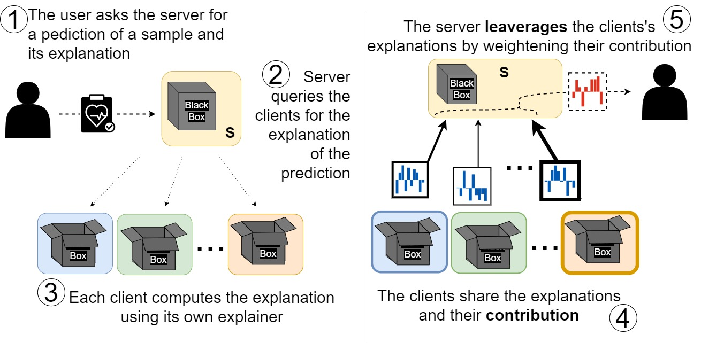
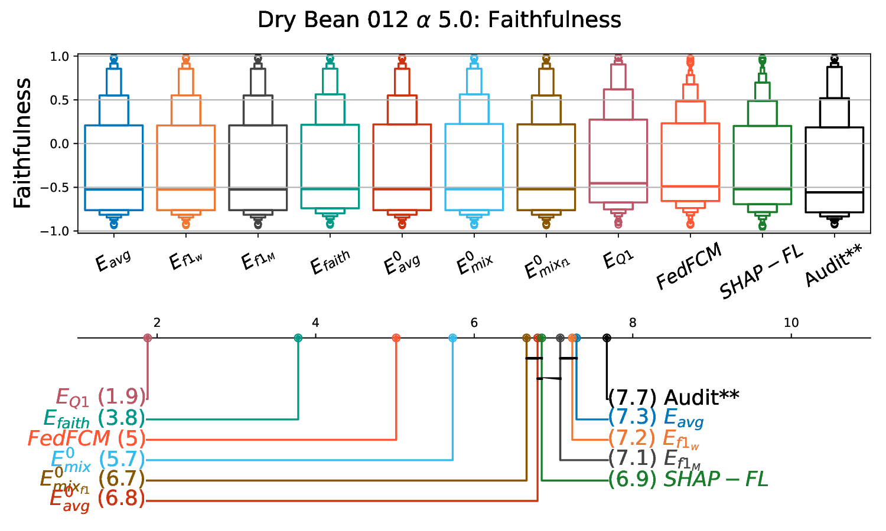
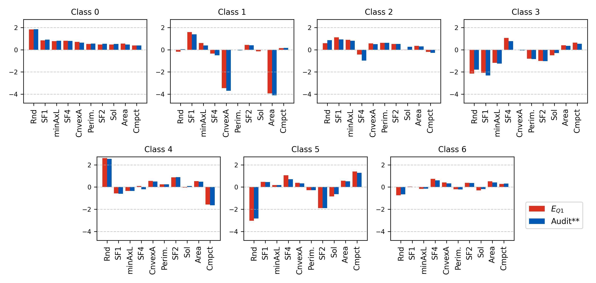
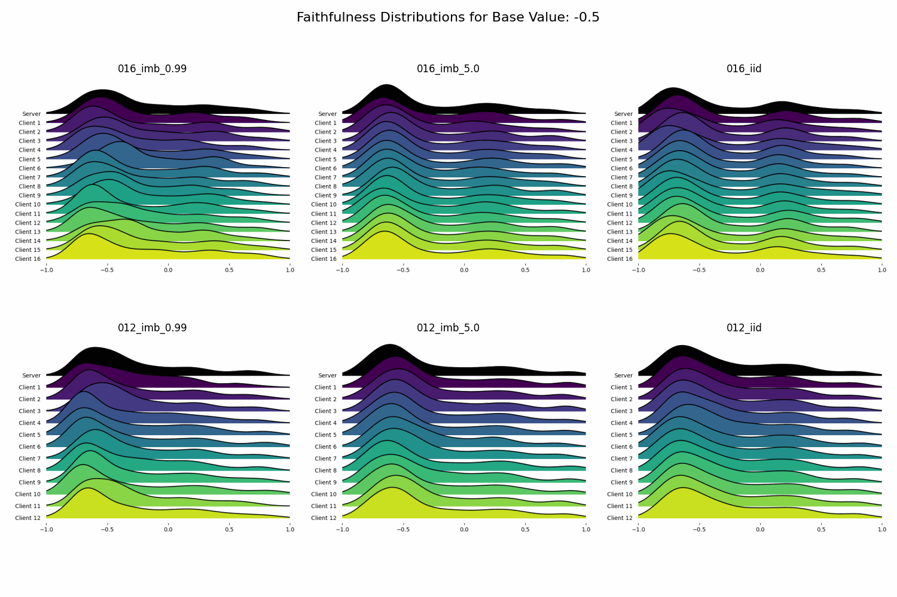

# iFLASH: Interpreting Federated Learning by Aggregating SHAP Explanations


[](https://ieeexplore.ieee.org/document/11534187)
[](https://opensource.org/licenses/MIT)

Code accompanying the paper

> [**Interpreting Federated Learning by Aggregating SHAP Explanations**](https://ieeexplore.ieee.org/document/11534187)
> by Valerio Bonsignori, Luca Corbucci, Francesca Naretto, Riccardo Guidotti, Anna Monreale

Federated Learning (FL) trains models without moving data off the clients, but
standard explainers need centralised data. **iFLASH** explains a federated
model without that access. Each client runs a local SHAP explainer on its own
data and rates its explanations with Faithfulness. The server then aggregates
the clients' feature importances, weighting each client by the quality of its
explanation and its model performance. No raw data, models or gradients are
exchanged for this step.

<p align="center">
  
</p>


## Aggregation strategies

Each strategy combines, sample by sample, the SHAP explanations
$\phi_c$ of the clients $c \in C$. Each client explanation comes with its

[Faithfulness](https://papers.nips.cc/paper/8003-towards-robust-interpretability-with-self-explaining-neural-networks.pdf)
 $faith_c \in [-1, 1]$ and the client's (macro) F1 score. The
implementation is in [`iflash/aggregation.py`](iflash/aggregation.py).

| Paper | Code key | Aggregation |
|---|---|---|
| $E_{Avg}$ | `E_hat` | plain average |
| $E_{F1}$ | `E_weighted` | average weighted by the client's F1 score |
| $E_{F1_{macro}}$ | `E_f1_macro` | average weighted by the client's macro F1 |
| $E_{faith}$ | `E_fait_weighted` | average weighted by Faithfulness, rescaled to $(faith+1)/2$ |
| $E^0_{Avg}$ | `E_avg_t_0` | average of the explanations with $faith > 0$ |
| $E_{Mix}$ | `E_mixed` | $E_{faith}$ over the explanations with $faith > 0$; if there are none, macro-F1 weighted average of all of them |
| $E_{Mix_{F1}}$ | `E_mix_f1` | macro-F1 weighted average of the explanations with $faith > 0$ |
| $E_{Q1}$ | `E_Q1` | average of the top 25% most faithful explanations |
| Audit | `Server` | centralised explainer with access to all the data (reference) |
| FedFCM | `COMP` | competitor: federated fuzzy C-means background dataset |
| SHAP-FL | `SHAP_FL` | competitor: per-client synthesised background dataset |

Explanations are compared with the Audit using the ShapGap measures
(L2, cosine similarity, Spearman, Kendall; [`iflash/metrics.py`](iflash/metrics.py)).
Strategies are ranked with Friedman/Nemenyi tests and critical-difference
diagrams ([`iflash/statistics.py`](iflash/statistics.py)).

## Example results

Faithfulness of each aggregation strategy on Dry Bean with 12 clients and moderate
imbalance (Dirichlet α = 5.0). Top: distribution. Bottom: critical-difference diagram
(lower rank is better).

<p align="center"></p>

Global feature importance by class for the same setting: $E_{Q1}$ (red) against the
centralised Audit (blue).

<p align="center"></p>

Distribution of the Faithfulness of the server and of every client's explanations
as the base value used to compute Faithfulness changes (Dry Bean, all settings).

<p align="center"></p>


## Citation

If you use this code, please cite the paper:

```bibtex
@article{bonsignori2026iflash,
  title   = {Interpreting Federated Learning by Aggregating SHAP Explanations},
  author  = {Bonsignori, Valerio and Corbucci, Luca and Naretto, Francesca and Guidotti, Riccardo and Monreale, Anna},
  journal = {IEEE Access},
  year    = {2026}
}
```


## Repository structure

```
iflash/                    server-side analysis library (import iflash as flx)
├── naming.py              method keys, paper labels (res_d) and colors
├── metrics.py             ShapGap measures
├── faithfulness.py        Faithfulness of local explanations (aix360)
├── aggregation.py         aggregation strategies, policy_selection, global explanations
├── plotting.py            figures used in the paper and in the analysis
└── statistics.py          Friedman/Nemenyi tests, critical-difference diagrams
src/                       shared utilities: datasets, preprocessing, model, training,
                           SHAP explainer, CLI arguments, W&B helpers
cross_silo/                cross-silo pipeline (Adult, Diamond, Dry Bean; 12 and 16 clients)
├── create_folders_and_partitions.py   IID / Dirichlet non-IID partitions and folder tree
├── fedAvg_server.py, basic_client.py  Flower FedAvg server and client
├── sim.py                             Flower simulation (used for HP sweeps / final runs)
├── local_model_for_HP.py              centralised model for hyperparameter search
├── create_shap_explanation.py         local SHAP explanations of each client and of the Audit
├── create_sampled_shap_explanations.py  SHAP-FL competitor (background sampling)
├── competitor_shap_explanations.py    FedFCM competitor (clustering background)
├── create_tables.py                   LaTeX tables of the results
├── scripts/                           shell drivers (partitioning, FL runs, sweeps, explanations)
└── configs/                           W&B sweep configurations
cross_device/              cross-device setting (Dutch: 50/70/150 clients; ACSI: 51 states)
├── nodes.py, 70_nodes.py, 150_nodes.py  train/test node splits
├── models/                            model definition
└── utils/                             tabular dataset class
notebooks/                 analyses that produce the paper's figures and tables (outputs kept)
assets/                    figures used in this README
data/                      dataset sources and expected layout
```

### Notebooks

| Notebook | Content |
|---|---|
| [`cross_silo_analysis.ipynb`](notebooks/cross_silo_analysis.ipynb) | Faithfulness, aggregation, ShapGap and global explanations for the cross-silo experiments |
| [`faithfulness_joyplots.ipynb`](notebooks/faithfulness_joyplots.ipynb) | Faithfulness distributions (joyplots) and CD diagrams across datasets and distributions |
| [`critical_difference_diagrams.ipynb`](notebooks/critical_difference_diagrams.ipynb) | CD diagrams from the per-dataset rank tables |
| [`hyperparameter_sweeps.ipynb`](notebooks/hyperparameter_sweeps.ipynb) | Results of the federated hyperparameter sweeps (W&B) |
| [`cross_device_analysis.ipynb`](notebooks/cross_device_analysis.ipynb) | Cross-device analysis (ACSI) |
| [`cross_device_analysis_dutch.ipynb`](notebooks/cross_device_analysis_dutch.ipynb) | Cross-device analysis (Dutch, 50/70/150 clients) |
| [`cross_device_plots.ipynb`](notebooks/cross_device_plots.ipynb) | Summary plots and tables across datasets and settings |
| [`cross_device_fast_faithfulness.ipynb`](notebooks/cross_device_fast_faithfulness.ipynb) | Minimal Faithfulness recomputation (Dutch, 70 nodes, α = 5.0) |
| [`cross_device_wandb_runs.ipynb`](notebooks/cross_device_wandb_runs.ipynb) | Training curves of the cross-device runs (W&B) |

## Experimental pipeline (cross-silo)

The scripts were run from the repository root, with the repository root on
`PYTHONPATH` (`export PYTHONPATH=$(pwd)`):

1. **Partitioning.** `create_folders_and_partitions.py` splits each dataset into
   12 or 16 clients, either IID or non-IID with Dirichlet α ∈ {5.0, 0.99}. It also
   creates the `Experiments/<dataset>/<experiment>/` tree. `scripts/StartFederated.sh`
   runs this step and the next one.
2. **Federated training.** A FedAvg model is trained with
   [Flower](https://flower.ai) (`fedAvg_server.py` + `basic_client.py`, or `sim.py`).
   Hyperparameters were selected with W&B Bayesian sweeps (`scripts/sweep_*.sh`, `configs/`).
3. **Local explanations.** Every client, and the centralised Audit, explains the
   global model on the test set with KernelSHAP (`create_shap_explanation.py`,
   driven by `scripts/run_explanations.sh`). The competitors are computed with
   `competitor_shap_explanations.py` and `create_sampled_shap_explanations.py`
   (`scripts/run_all_competitors.sh`).
4. **Faithfulness, aggregation and evaluation.** This happens in the notebooks
   with the `iflash` library: `compute_faithfulness`, then `policy_selection`,
   ShapGap against the Audit, `create_df_and_check` for CD diagrams, and
   `cross_silo/create_tables.py` for the tables.

In the cross-device setting the federated models were trained separately. The
node splits are in `cross_device/`, and explanation, aggregation and evaluation
are in the `cross_device_*` notebooks.

<!-- ## Status and known limitations 

- **Reference code, not a package.** Paths, dataset names and experiment
  identifiers are the ones used during the experiments. The notebooks expect
  result files (SHAP values, Faithfulness dictionaries, models) that are not
  distributed. The notebooks were moved and renamed when the repository was
  cleaned up, so their relative paths may need adjusting.
- **External dependencies:**
  - Partitioning uses the `FederatedDataset` package
    (`from FederatedDataset.FederatedDataset.PartitionTypes...`), developed
    within the [Pistacchio-Federated-Learning](https://github.com/Pistacchio-Federated-Learning)
    group and not included here.
  - The SHAP-FL competitor imports `HistSampler` from
    [SHAP_FL](https://github.com/valevalerio/SHAP_FL).
  - Faithfulness is computed with [aix360](https://github.com/Trusted-AI/AIX360).
    CD diagrams use [scikit-posthocs](https://github.com/maximtrp/scikit-posthocs).
  - Experiment tracking uses [Weights & Biases](https://wandb.ai).
- `requirements.txt` is a freeze of the original environment (Python 3.8).
  Some pins are platform specific.
- `iflash/` is a refactoring of the single-file analysis library used for the
  paper (`flexai_lib.py`). The module layout and docstrings are new; the
  numerical behaviour is unchanged. `from iflash import *` exposes the same
  names as the original module, which the notebooks rely on.
-->


## Citation

If you use this code, please cite the paper:

```bibtex
@article{bonsignori2026iflash,
  title   = {Interpreting Federated Learning by Aggregating SHAP Explanations},
  author  = {Bonsignori, Valerio and Corbucci, Luca and Naretto, Francesca and Guidotti, Riccardo and Monreale, Anna},
  journal = {IEEE Access},
  year    = {2026}
}
```